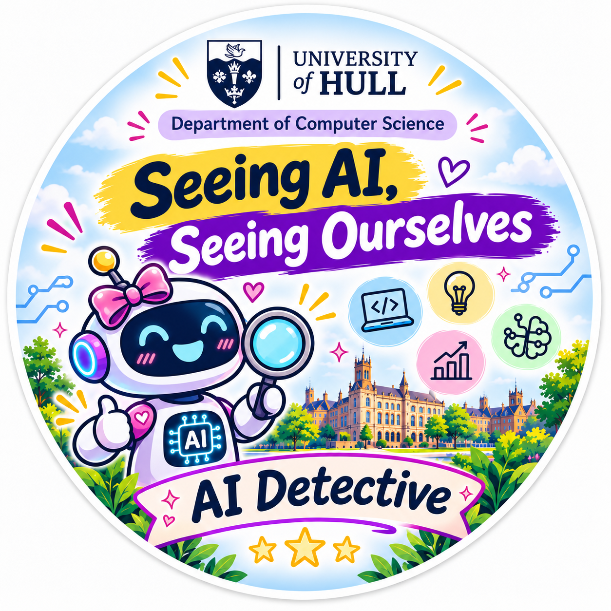

<div align="center">
  

  # Seeing AI, Seeing Ourselves

  **Workshop 1: How Computers See**

  An interactive introduction to image classification, training data and AI mistakes — no coding required.

  *University of Hull · Department of Computer Science*
</div>

## About the workshop

**Seeing AI, Seeing Ourselves** is an outreach workshop series designed to help school pupils explore artificial intelligence through accessible activities and discussion. Workshop 1, **How Computers See**, introduces how image classifiers learn from labelled examples, make predictions and sometimes get things wrong.

The central message is that AI is not just about writing code: it is also about recognising patterns, asking questions, testing ideas and thinking about the people affected by technology.

## Try the interactive demo

The **Cup or Bottle? Live Classifier** is a self-contained educational webpage.

**[Open the demo file](Seeing_AI_Workshop1_Live_Demo.html)** (then download it using GitHub's **Download raw file** control and open the downloaded `.html` in a web browser).

To run it locally:

1. Download `Seeing_AI_Workshop1_Live_Demo.html` from this repository.
2. Double-click the file to open it in Chrome, Edge, Firefox or Safari.
3. Choose **Dataset A** or **Dataset B**, then click **Train the model**.
4. Select a new test picture, predict what the model will say, and click **Run the model**.
5. Try **Make a challenge** to vary the object's angle, background, size or lighting; use **Test log** to compare results.

The demo works **offline**. It does not need an account, internet connection, webcam, pupil photographs or file uploads.

## What pupils can explore

- **Collect and label:** see how examples are assigned to the `cup` or `bottle` category.
- **Training versus testing:** learn why the model should be tested on new images.
- **The wrong clue:** compare Dataset A (backgrounds associated with labels) against Dataset B (more varied examples).
- **Improve the training set:** add, remove or deliberately mislabel pictures and test how the results change.
- **Unfamiliar objects:** try an apple or vase and discuss why a two-class model cannot answer “neither”.
- **Test one change at a time:** experiment with angle, colour, background, size and lighting.

### Suggested classroom sequence

| Stage | Classroom prompt |
| --- | --- |
| Predict | “What do you think the AI will say?” |
| Train | “Which examples have we shown it?” |
| Test | “Did it get this new picture right?” |
| Investigate | “Did it learn the object, or a misleading clue?” |
| Improve | “What different training examples would help?” |

## How the demo works

This is a **simplified educational classifier**, not a production computer-vision system. Each prepared picture is represented as **16 × 16 coloured pixels**. For a new picture, the classifier finds the **five most similar training pictures** and uses their labels to vote for `cup` or `bottle`.

The five votes illustrate the decision process; they **are not a calibrated confidence percentage**. Predictions can change when training examples change. The demo is intended to prompt discussion, not to demonstrate the performance or fairness of real-world AI systems.

## Repository files

```text
SeeingAI-SeeingOurselves/
├── README.md
├── Seeing_AI_Workshop1_Live_Demo.html
└── assets/
    └── ai-detective-badge.png
```

## Privacy and safe use

The demonstration uses prepared illustrations of objects. No pupil photos, names, webcam streams or personal information are required. Activities involving pupils, consent or feedback collection should follow the school's and university's applicable safeguarding, data-protection and research-ethics arrangements.

## Project and acknowledgements

Developed as part of the **Seeing AI, Seeing Ourselves** school outreach activities associated with the **University of Hull, Department of Computer Science**.

**Workshop material contact:** Parvin Ghaffarzadeh.

The badge artwork is included for this workshop's presentation and documentation. University names, crest and related branding remain subject to the relevant institutional permissions. Please do not assume that the badge or institutional marks are openly licensed for unrestricted reuse.

## Notes

This repository contains an **educational demonstration**. It is not a validated AI product, and the exercise is not evidence of the fairness or accuracy of real-world image-recognition systems.


## Workshop 1 – Feedback Forms

The following questionnaires are used to gather feedback
during Workshop 1: How Computers See.

### 1. Student Questionnaire – Beginning of the Presentation

Pupils complete this short questionnaire at the beginning
of the presentation, before the main activities.

[Complete the Beginning Questionnaire](https://forms.cloud.microsoft/Pages/ResponsePage.aspx?id=l4EKSYN7EE-JuYMYm-ODXkA9jNL4Vy9IrsQnvaSGLdVUNDNFTVBVVVhGOVBEV0JZQTBMTFNBNU5CWi4u)

### 2. Student Questionnaire – End of the Presentation

Pupils complete this questionnaire at the end of the
presentation to share their experience and feedback.

[Complete the End Questionnaire](https://forms.cloud.microsoft/Pages/ResponsePage.aspx?id=l4EKSYN7EE-JuYMYm-ODXkA9jNL4Vy9IrsQnvaSGLdVUMlJCUTVRSjhBWDA3TE1CWFdQUFROQTdEWi4u)

### 3. Teacher Feedback – After the Workshop

Teachers are invited to provide feedback on the workshop
content, delivery, and pupils' engagement.

[Complete the Teacher Feedback Form](https://forms.cloud.microsoft/Pages/ResponsePage.aspx?id=l4EKSYN7EE-JuYMYm-ODXkA9jNL4Vy9IrsQnvaSGLdVUNklZWjIyOUgzVlU5QkpNS1JFMU43OERTRS4u)
